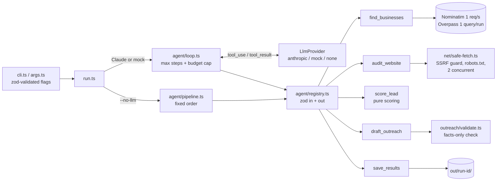

# Lead Research Agent

A command-line agent that finds local businesses on OpenStreetMap, audits their websites, ranks them by how much they could use a new website or chat assistant, and drafts short outreach emails for a person to review. **It never sends anything.**

```bash
npm run agent -- --niche plumber --city "Austin, TX" --limit 15            # Claude agent mode (needs API key)
npm run agent -- --niche plumber --city "Austin, TX" --limit 15 --no-llm   # template mode: real data, no AI, free
npm run agent -- --niche plumber --city "Austin, TX" --mock                # offline demo: fixtures + mock LLM
```

## What it does

1. **Find businesses.** Geocodes the city with Nominatim, then runs one Overpass query for the niche's OSM tags (`src/config/niches.ts`: plumber → `craft=plumber`, hvac → `craft=hvac` / `shop=hvac`, dentist → `amenity=dentist`, and so on). It keeps the name, website, phone, address and OSM id.
2. **Audit each website.** Checks HTTPS (and whether an HTTPS version exists), the mobile viewport tag, title and meta description, response time, HTML size, chat widgets (about 18 vendors plus generic markers), contact or quote forms (including embedded form builders), the footer copyright year, and redirects. Businesses with no website are kept and flagged, because they are often the best leads.
3. **Score leads.** A pure function with documented weights (`src/scoring/weights.ts`). No website +70, site unreachable +40, no HTTPS +20, no viewport +20, slow (>3 s) / no chat / no form / copyright two or more years old +10 each, minor SEO gaps +5, listed phone +5, capped at 100. A signal the audit could not measure never adds points.
4. **Agent loop.** Claude orchestrates five tools (`find_businesses`, `audit_website`, `score_lead`, `draft_outreach`, `save_results`) through the Messages API tool-use loop, with a step limit and a USD budget cap.
5. **Outreach drafts.** Short emails for the top leads, validated against the audit facts (see Guardrails). Drafts that fail are retried once with the errors, then dropped and logged.
6. **Human in the loop.** Results go to `out/<run-id>/` for review:

| File | Contents |
| --- | --- |
| `report.md` | Summary metrics, top 10 leads with reasons, OSM attribution |
| `leads.csv` / `leads.json` | Every business with its audit, score, findings and draft status |
| `drafts.md` | Drafts for review, each listing the facts it relies on |
| `run-log.jsonl` | Every LLM call and tool call with input, timing, result or error |
| `cost.json` | Tokens in/out and estimated USD (or "no LLM used") |

## Architecture



## The three modes

| Mode | Flag | Data | Drafts written by | Needs |
| --- | --- | --- | --- | --- |
| Claude agent | (default) | Live OSM + live websites | Claude, then validated | `ANTHROPIC_API_KEY` |
| Template | `--no-llm` | Live OSM + live websites | Fixed templates built only from audit facts | nothing |
| Mock | `--mock` | Fictional fixtures, fully offline | Mock LLM (template text labelled MOCK) | nothing |

Template mode is the free mode for real prospecting. Its drafts are **not AI-written** and `drafts.md` says so. It calls the same tools in a fixed order and runs every draft through the same validator. Mock mode exists to demo and test the agent loop without a key or network. Its "LLM" replays the intended tool-call sequence, and its token counts are estimates. `--mock --no-llm` runs template mode on the fixtures.

Claude agent mode has not been run against the live API yet, because no key was available when this was built. The provider follows the installed SDK's `messages.create` types (`@anthropic-ai/sdk` 0.131): client tools, `tool_use` blocks, `tool_result` replies, and a forced `submit_draft` tool for drafts.

## Guardrails

**Network (website URLs come from OSM, so they are untrusted)**
- Only `http`/`https` on ports 80/443. URLs containing credentials are rejected.
- DNS is resolved before connecting and **every** address is checked. Private, loopback, link-local, CGNAT, cloud-metadata, multicast, reserved and documentation ranges are blocked for IPv4 and IPv6. IPv4 embedded in IPv6 (mapped, NAT64, 6to4) is unwrapped and checked too. The socket is pinned to the checked address, so there is no second lookup and no DNS rebinding.
- Redirects are followed manually (at most 3) and each hop is validated again, including robots.txt for any new origin.
- 8 s deadline per fetch, 1.5 MB cap on the decompressed body (protects against gzip bombs), no cookies sent or stored.
- robots.txt (RFC 9309) is checked against the actual path before every fetch, including each redirect target. A disallowed site is skipped and flagged, and so is one whose robots.txt is unreachable. 401/403/429 responses are treated as "access denied", not as a broken site.
- Polite rate limits: Nominatim at most 1 request per second, one Overpass query per run, at most 2 website fetches at a time. A fetch holds its slot for one network hop only, so a redirect that needs robots.txt cannot deadlock the run.
- The User-Agent names the tool and the contact in `LEAD_AGENT_CONTACT`. Live runs warn when it is unset. Placeholder domains such as `example.com` are refused, because Nominatim blocks them.
- The Anthropic base URL is pinned, so an environment override cannot redirect the API key to another host.

**Model output is never trusted**
- Every tool input and output is validated with zod. Invalid input goes back to the model as an `is_error` result. The search is locked to the run's niche and city, and the number of drafts per run is capped.
- Drafts must parse as strict JSON: subject ≤ 60 chars, body ≤ 120 words, 1-2 findings, opt-out line, `[Your Name]` placeholder.
- **Facts-only check.** Phrases are matched to claims, and each claim names the specific findings that can back it, so "no HTTPS" needs `no_https` and is not satisfied by a missing redirect. Any claim the audit did not establish is rejected. Durations must match the measured response time, and years must match the audited copyright year. Other digits and number words are rejected, and so are links and domains, prices, percentages, email addresses, markup, and claims about competitors, reviews or results. Text is NFKC-normalized and stripped of invisible characters before checking, so fullwidth digits or zero-width characters cannot slip past.
- Business names are wrapped as untrusted data in prompts and cleaned of control and bidi characters. They are escaped in Markdown, with links and emails defanged, and protected against formula injection in CSV. A name that carries a link or a price causes the draft to be dropped.
- Hard stops: `--max-steps` (default 20) and `--budget` (default $0.50). The budget is checked **before** every call against that call's worst-case cost. Results are always written, even after an early stop.

**Data ethics**
- Only public business listing data is used: name, website, phone, address and OSM id. No email addresses are scraped from pages and no social profiles are collected.
- For sole traders, a business name and phone number can still count as personal data under GDPR and UK GDPR. Keep `out/` private (it is gitignored) and delete runs you no longer need.
- Nothing is sent. Outreach must comply with **CAN-SPAM** and local law: use your real identity and postal address, write honest subject lines, and honour opt-outs. The opt-out line is mandatory in every draft.
- OSM data is © OpenStreetMap contributors under the **ODbL**, and every `report.md` includes the attribution.

## Sample `report.md` (from the mock run, fictional businesses)

| Metric | Value |
| --- | --- |
| Businesses found | 10 |
| No website listed | 2 of 10 (20%) |
| Websites audited successfully | 5 of 8 |
| No HTTPS (of audited sites) | 1 of 5 (20%) |
| Not mobile-friendly (of audited sites) | 2 of 5 (40%) |
| Outreach drafts written / dropped | 5 / 0 |
| Stop reason | `saved` |

| # | Business | Score | Website | Why |
| --- | --- | --- | --- | --- |
| 1 | Lone Star Plumbing | 90 | lonestar-plumbing.example | no HTTPS (+20); not mobile-friendly (no viewport) (+20); slow homepage (+10); no chat widget (+10); ... |
| 2 | Barton Creek Plumbing | 75 | (none) | no website listed (+70); has phone (+5) |
| 3 | Eastside Drain Pros | 70 | (none) | no website listed (+70) |
| 4 | Austin Leak Fix | 55 | austin-leak-fix.example | not mobile-friendly (no viewport) (+20); no chat widget (+10); no contact form on homepage (+10); ... |
| 10 | Riverside Plumbing | 5 | riverside-plumbing.example | has phone (+5); audit skipped: robots.txt disallows |

## Running it

Requirements: Node.js 22.18 or later. TypeScript runs natively through Node's type stripping, so there is no build step.

```bash
npm install
npm test            # vitest: SSRF guard, robots, parsing, scoring, validation, agent loop, CSV
npm run typecheck   # tsc --noEmit
npm run eval        # 8 fixture businesses, pass/fail table (mock LLM)
npm run agent -- --mock --niche plumber --city "Austin, TX"
```

Real runs: `cp .env.example .env` and set `LEAD_AGENT_CONTACT` (your email or https URL, sent in the User-Agent). For Claude agent mode, also set `ANTHROPIC_API_KEY`. `LEAD_AGENT_MODEL` defaults to `claude-haiku-4-5-20251001`, and `claude-sonnet-5-5` also works. `npm run eval -- --real` grades Claude-written drafts on the same fixtures. Without a key, agent mode exits with a message pointing to `--mock` or `--no-llm`.

Flags: `--niche`, `--city`, `--limit` (1-50, default 15), `--drafts` (0-10, default 5), `--max-steps`, `--budget`, `--mock`, `--no-llm`, `--out`.

## Cost per run (estimate)

A 15-business run takes about 6 agent turns plus up to 5 draft calls, roughly 30k input and 4k output tokens. That works out to about **$0.03-0.06 on Claude Haiku 4.5** ($1 / $5 per million tokens) and about **$0.10-0.20 on a Sonnet-class model** ($3 / $15). These figures are projections, not measurements, because no paid run has been made yet. Check `cost.json` after a real run. The `--budget` cap is enforced either way. Template and mock modes cost nothing. The price table is in `src/llm/cost.ts`, and unknown models fall back to a deliberately high rate.

## Limitations

- OSM coverage of small businesses varies by city. Many businesses are missing or have no website tag, so "no website listed" means none is listed in OSM. Verify before claiming it.
- Only the homepage is audited. Chat widgets loaded late by JavaScript, and forms on other pages, are not detected. Response time is one sample from the machine running the tool.
- Sites behind bot protection (403/429) or with restrictive robots.txt are skipped, so the tool makes no claims about them. In the first live run (plumbers, Austin TX), 3 of 7 websites were skipped this way.
- There is no per-host throttle. Several listings that point at the same domain are fetched one after another, still at most 2 at a time.
- Claim detection is pattern-based. It is strict on purpose and may reject some valid drafts, and a person still has to review every draft.
- No contact emails are collected. Finding the right contact address and sending are manual steps by design.

## License

MIT. See `LICENSE`. Business data © OpenStreetMap contributors (ODbL).
